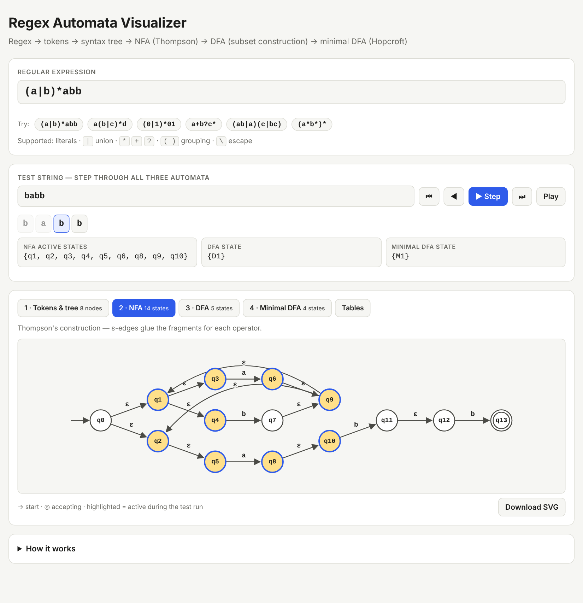
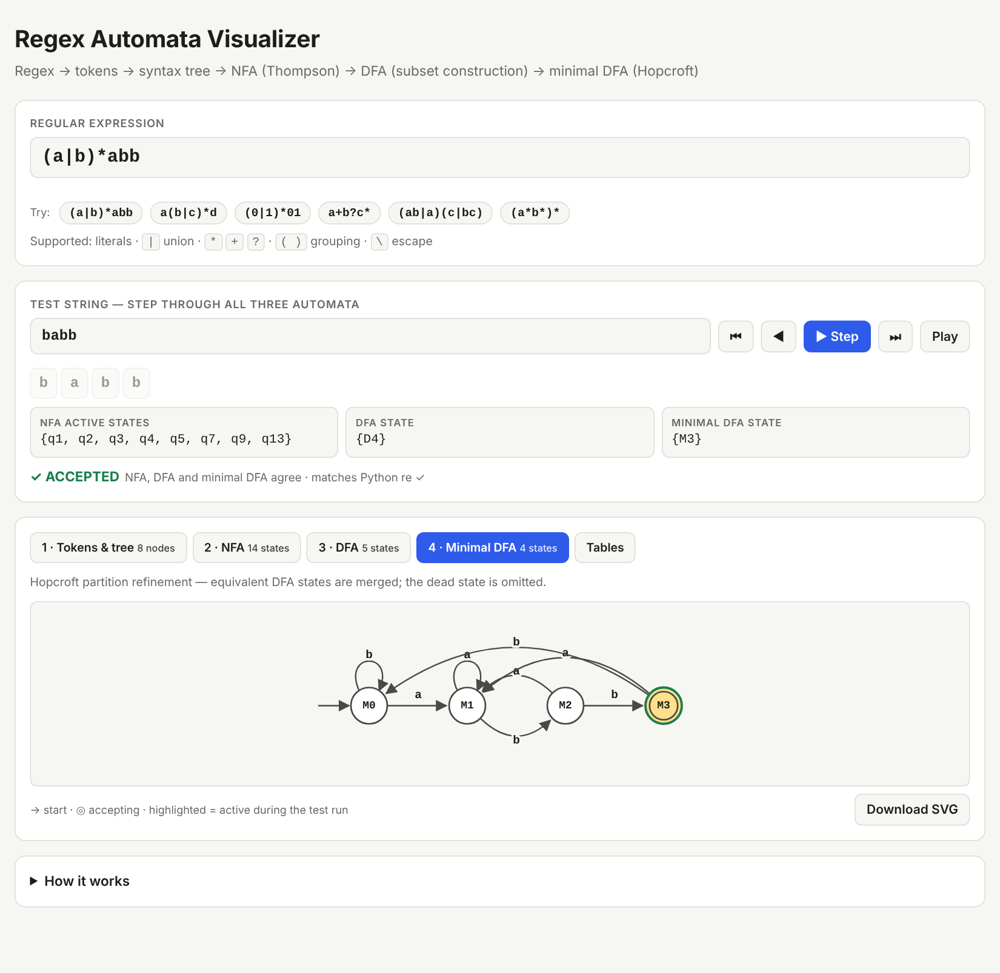

# regexlab — Regex → NFA → DFA → Minimal DFA Visualizer

A compiler-design mini project in pure Python (standard library only). Type a
regular expression and watch it travel through every phase of a small compiler
front end:

```
regex → tokens → syntax tree → ε-NFA (Thompson) → DFA (subset construction) → minimal DFA (Hopcroft)
```



## Features

- **Hand-written lexer and recursive-descent parser** with positioned error messages
- **Thompson's construction**, **subset construction** and **Hopcroft minimisation**, each in its own module
- **Interactive web demo**: step through a test string and see the active states highlighted in all three automata at once
- **CLI**: prints tables and traces, exports `.svg`, `.dot` (Graphviz) and a self-contained `report.html`
- **Transition tables** showing which NFA states each DFA state contains and which DFA states were merged
- **Self-checking**: every run is compared with Python's `re` engine; 39 unit tests including an independent Myhill–Nerode minimality check
- No dependencies, no build step, own SVG layout engine

## Quick start

Requires Python 3.9+.

```bash
# interactive demo (opens http://127.0.0.1:8000)
python -m regexlab --serve

# command line
python -m regexlab "(a|b)*abb" -t babb -t abab
python -m regexlab "(a|b)*abb" -t babb -o out/      # writes out/{nfa,dfa,min}.{svg,dot} + out/report.html
python -m regexlab --help
```

Optional install as a command: `pip install .` then `regexlab "a(b|c)*d"`.

Graphviz users can re-render the exported graphs: `dot -Tpng out/min.dot -o min.png`.

## Example: `(a|b)*abb`

| Stage | States | Note |
|---|---|---|
| ε-NFA | 14 | Thompson's construction |
| DFA | 5 | subset construction |
| Minimal DFA | 4 | Hopcroft merges D0 and D2 |

Full sample output (terminal trace, SVGs, DOT, HTML report) is in [`examples/abb/`](examples/abb/).



## Syntax supported

| Syntax | Meaning |
|---|---|
| `ab` | concatenation |
| `a\|b` | union |
| `a*` `a+` `a?` | zero or more, one or more, optional |
| `( )` | grouping |
| `\` | next character is a literal (`\*`, `\|`, `\\` ...) |

Matching is whole-string. Character classes, `.`, `{m,n}` and anchors are intentionally left out; see [docs/DESIGN.md](docs/DESIGN.md#6-limitations--extensions).

## Project layout

```
regexlab/
  lexer.py  parser.py            front end (tokens, grammar, AST)
  thompson.py  subset.py  hopcroft.py   the three algorithms
  simulate.py                    step-by-step runs + Python `re` oracle
  render.py  tables.py  report.py       SVG/DOT, tables, HTML report
  api.py  server.py  web/        interactive demo (stdlib http.server + vanilla JS)
  cli.py  __main__.py            command line
tests/                           39 unit tests (python -m unittest)
docs/DESIGN.md                   architecture, algorithms, complexity, test strategy
examples/abb/                    sample generated output
```

## Tests

```bash
python -m unittest            # 39 tests, ~1 s
```

Highlights: random regexes are checked against `re.fullmatch` on every string up to length 6;
the minimal DFA's size is verified against an independent table-filling (Myhill–Nerode) implementation.

## Honest notes

- Hopcroft's smaller-half splitting rule is implemented, but pre-images are found by scanning all states, so the worst case is O(|Σ|·n²) rather than the textbook O(|Σ|·n log n). Details in the design notes.
- Concatenation uses ε-links instead of merged states (Sipser style), so the NFA has a few more states than Aho et al.'s figures; the DFA and minimal DFA are identical.
- Subset construction is capped at 2000 DFA states to avoid exponential blow-up.

## References

1. K. Thompson, "Regular expression search algorithm", *CACM* 11(6), 1968.
2. M. O. Rabin, D. Scott, "Finite automata and their decision problems", *IBM J. Res. Dev.* 3(2), 1959.
3. J. E. Hopcroft, "An n log n algorithm for minimizing states in a finite automaton", 1971.
4. A. V. Aho, M. S. Lam, R. Sethi, J. D. Ullman, *Compilers: Principles, Techniques, and Tools*, 2nd ed., 2006.
